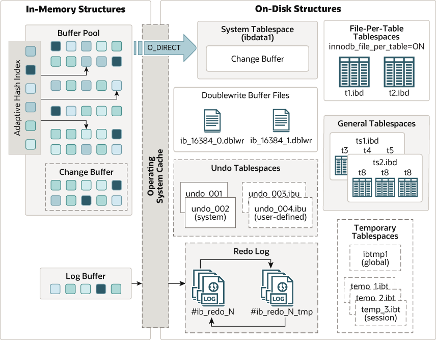

# Innodb
## 逻辑存储结构
```

1.Table space(表空间)
    Segment

2.Segment(段)
    Extent

3.Extent(区)
    Page

4.Page(页)
    Row

5.Row(行)
    trx id
    roll_pointer
    col1
    col2
    col3
    .....

```

### Table space(表空间)
```
ibd 文件
一个mysql实例可以对应多个表空间,用于存储记录,索引等数据

表空间文件存储地址
/var/lib/mysql

```
### Segment(段)
```
段分为
数据段(Leaf node segment),索引段(non-leaf node segment),回滚端(Rollback segment)


InnoDB是索引组织表
    数据段是B+tree 叶子节点
    索引段是B+tree 非叶子节点

段可以管理区

```
### Extent(区)
```
表空间单元结构每个区大小1MB

默认情况下,Innod引擎也大小为16k,每一个区64个页

```
### Page(页)
```
每个页16kB

Innodb管理的最小单元,为了保证页的连续性,Innodb引擎每次从磁盘申请4-5个区

表结构和索引都是在Page 这个逻辑结构存储
```
### Row(行)
```
Innodb 存储的数据

 隐藏字段
 trx id 每次对某条记录修改的时候都会把对应的事务id复制给 trx id
 roll_pointer 每次对某条记录修改的时候 都会将就的版本写入到undolog 日志中,roll_pointer 指向undolog 日志写入位置的指针


 col1
 col2
 col3

```
## 架构

### Innodb 的内存结构
```
1.
Buffer pool
    缓存磁盘中经常操作的数据,如果Buffer Pool 没有改数据则会请求加载对应的数据到Buffer Pool 中,然后对里面的数据进行增删改 查。 然后在以一定的频率将 Buffer Pool 中的数据刷新到磁盘中


Page 为单位 内部使用链表的形式进行管理

free Page 空闲页未被使用
clean Page 页被使用 未被修改
dirty Page 页被使用 被修改 与磁盘数据不一致


2.
change Buffer(更改缓冲区)
note:
  非唯一二级索引页
  

在增删改的时候 如果buffer pool 还没有数据 这个时候不会读取数据而是将修改的数据写入到change buffer ,在未来数据被读取时将数据和并到buffer pool 中


非唯一二级索引是以相对随机的插入的二级索引中，删除和更新操作会造成大量的IO.


3.
Adaptive Hash Index

自适应hash 索引，无需人工干预，系统自动完成


adaptive_hash_index


// 查看自适应hash 是否开启
show variables like '%hash_index%';

4.
log Buffer

    redo log buffer
    undo log buffer


```
