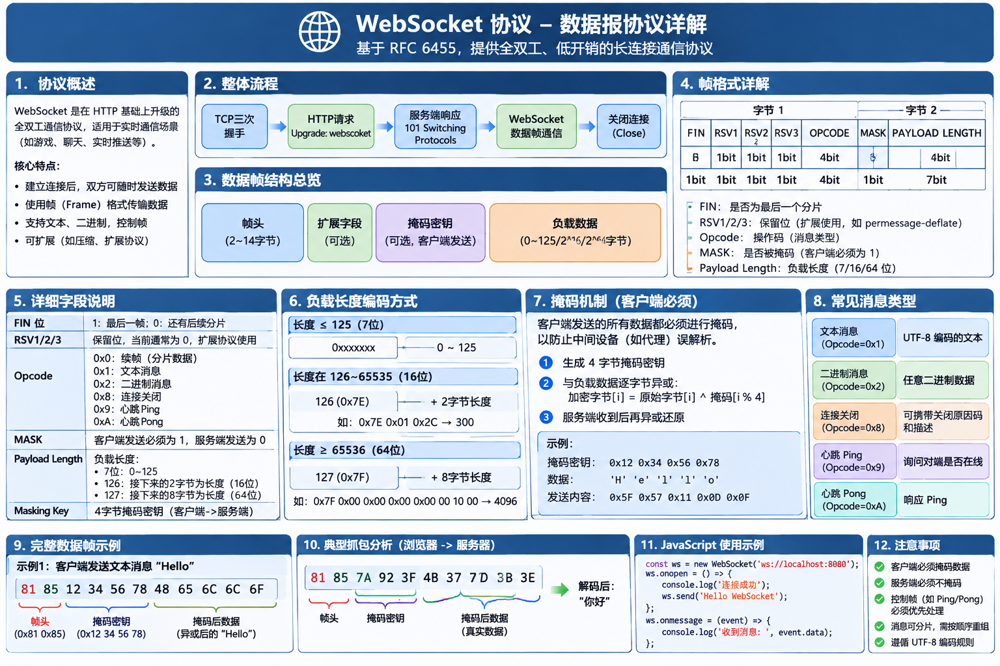

# socket2
```cpp
bind address
1.127.0.0.1 绑定是回环地址 只能在本机两个进程间通信
2.192.168.x.x 具体地址 绑定的是固定网卡的地址 只能请求该网卡ip 才能连接
3.0.0.0.0 绑定的是通配符地址  绑定本机多个网卡 任意网卡都能连接通信


htonl(INADDR_ANY) 本机字节序转为网络字节序


linux 设置非阻塞

void setFDBlock(int fd, int block)
{
    int flags = fcntl(fd, F_GETFL, 0);
    if (block)
    {
        /* code */
        flags &= ~O_NONBLOCK;
    }
    else
    {
        // 设置非BLOCK
        flags |= O_NONBLOCK;
    }
    fcntl(fd, F_SETFL, flags);
}


1.多线程 多进程
2.多路IO复用


int ret = recv;
ret==0 表示客户端调用close 关闭

```
**一请求一线程**
[code](./one_request_one_thread.c)
```
1.逻辑简单
2.缺点 线程占用资源多 代价太大,客户端并发不会太大


```

## IO 多路复用
```
作用:检测fd 是否有事件(读写....)

```
### select
[select](./select.c)
### epoll
[epoll](./epoll.c)
```cpp
#include <sys/epoll.h>

int epoll_create(int size);
   note: size 只需要大于0 就可以

int epoll_ctl(int epfd, int op, int fd,struct epoll_event *_Nullable event);
int epoll_wait(int n;int epfd, struct epoll_event events[n], int n,int timeout);


水平触发 (EPOLLLT) 默认
    只要状态在 就触发  比如 读写缓冲区有数据 就触发
    一次触发 读取一次数据 读取不完没有关系下一次还会触发
边缘触发(EPOLLET)
    只要状态改变 就触发 比如 读写缓冲区数据变化 就触发
    一次触发循环读    


```

## 服务器百万并发实现
```c
void *calloc(size_t count, size_t eltsize);


和 malloc 的区别
1.calloc 分配的内存 全部初始化为0


struct event_block
{
    struct sock_item *items;
    struct event_block *next
};


struct reactor
{
    int epfd;
    struct sock_item *items;
};


// 动态扩容数组
struct sock_item *items;
适用条件
1.有序,有规律


fd

五元组 (src ip  src port dst ip dst port proto)


src ip  src port(65535) dst ip  dst port(9999) proto(tcp)

src 是本机断开随机的
要让 无元组不通 可以 
  1.添加网卡 绑定不通的ip
  2.绑定多个端口


并发: 同时承载客户端的数量
  1.网络连接
  2.每个业务QPS
  3.断开连接的时候
  4.每一秒数据传输


100 W 并发决定的因素
1.epoll 100 万连接一点问题没有
```
## http
```
GET / HTTP/1.1\r\n
```
## websocket

```

// openssl 库安装
sudo apt install libssl-dev


TCP 处理分包粘包方式
1.分隔符
2.长度+数据


HTTP 使用\r\n\r\n 分割符来处理粘报

// 区分http是否是websocket 连接协议
Connection: Upgrade
Upgrade: websocket


WebSocket 握手 ->TCP 三次握手 ->client socket http Connection: Upgrade Upgrade: websocket


握手流程
1.客户端发送
2.服务器响应
    1.请求 Sec-WebSocket-Key  值获取
    2.GUID	"258EAFA5-E914-47DA-95CA-C5AB0DC85B11"
    3.Sec-WebSocket-Key值+GUID值连接
    4.SHA-1(Sec-WebSocket-Key值+GUID值)
    5.base65_encode(SHA-1(Sec-WebSocket-Key值+GUID值))
    6.响应 Sec-WebSocket-Accept 值 base65_encode(SHA-1(Sec-WebSocket-Key值+GUID值))


3.向客户端响应
HTTP/1.1 101 Switching Protocols
 Upgrade: websocket
 Connection: Upgrade
 Sec-WebSocket-Accept: xxxx


websocket 

1.握手
 判断是否存在  Sec-WebSocket-Key
  获取Sec-WebSocket-Key对应的值


   base64_encode(SHA-1(Sec-WebSocket-Key值+GUID值))  

2.数据传输格式


      0                   1                   2                   3
      0 1 2 3 4 5 6 7 8 9 0 1 2 3 4 5 6 7 8 9 0 1 2 3 4 5 6 7 8 9 0 1
     +-+-+-+-+-------+-+-------------+-------------------------------+
     |F|R|R|R| opcode|M| Payload len |    Extended payload length    |
     |I|S|S|S|  (4)  |A|     (7)     |             (16/64)           |
     |N|V|V|V|       |S|             |   (if payload len==126/127)   |
     | |1|2|3|       |K|             |                               |
     +-+-+-+-+-------+-+-------------+ - - - - - - - - - - - - - - - +
     |     Extended payload length continued, if payload len == 127  |
     + - - - - - - - - - - - - - - - +-------------------------------+
     |                               |Masking-key, if MASK set to 1  |
     +-------------------------------+-------------------------------+
     | Masking-key (continued)       |          Payload Data         |
     +-------------------------------- - - - - - - - - - - - - - - - +
     :                     Payload Data continued ...                :
     + - - - - - - - - - - - - - - - - - - - - - - - - - - - - - - - +
     |                     Payload Data continued ...                |
     +---------------------------------------------------------------+


状态机 WS_HANDSHARK WS_TRAMISSON WS_EN WS_COUNT


Payload len  < = 127


xor(^) 特点 xor  某一个数xor 偶数次还是自己

x^1^1=x 


自定义协议注意
1.tcp分包粘包
2.数据
    json/xml/protobuf....

```


### Reactor
```c

阻塞

   read/recv -> 检测是否有数据
       没有数据 阻塞 让出执行权限 直到有数据 拷贝 返回

       有数据 拷贝 返回


    write -> buf满的 阻塞 让出执行权限 直到buf有空闲 拷贝 返回
    write -> buf有空闲 拷贝 返回


非阻塞(write read recv ....可以检测缓冲去数据)
    write ()  buf 满的立即返回 -1
       errno  EAGAIN or EWOULDBLOCK
    
    read () 没有数据 立即返回 -1
       errno  EAGAIN or EWOULDBLOCK

       
       
errno EINTR 系统调用被其他中断打断 继续尝试读写


非阻塞
   connect() 第一调用肯定会返回 -1
            errno EINPROGRESS           
            多次调用 connect() -1
            errno EISCONN  socket 已经建立了连接


   listen(fd,backlog)
        backlog 全连接队列长度
        没有调用Accept 在全连接队列能够堆积多少个链接
        
    
    accept()
        返回 客户端fd and 客户端 ip port ...信息
        
        

        // 可以检测
        非阻塞情况下
        -1 errno EAGAIN or EWOULDBLOCK
            全连接队列为空 没有客户端连接

        

连接断开
    服务器主动关闭
    close()
       关闭读写端 和回收对应的资源
    shutdown()
        关闭读or 写端

    服务端被动关闭
       read/recv == 0
       服务端 close()
           更准确的说服务端读端关闭
       
       write()==-1 && errno=EPIPE
            可以检测服务端写端关闭


检测IO(IO多路复用不去具体操作IO只去检测IO的就绪状态)


socket() bind() listen() 
     listenfd 监听读事件 accept 获取连接对象


connect()  非阻塞第一个调用直接返回 -1  errno EINPROGRESS
           
           如果想通过IO多路复用 监听写事件


epoll EPOLLRDHUP 服务端读端不安比
epoll EPOLLHUP 服务端读写端都关闭


epoll EPOLLIN 
    clientfd 读事件 (表示缓冲区有数据)
    listenfd accept 事件

epoll EPOLLOUT (表示缓冲区可写)
    clientfd 写事件


1.epoll_crate()
   创建红黑树和双端队列数据结构
3.epoll_ctr
   EPOLL_CTL_ADD 添加事件
      向红黑树添加一个节点
   EPOLL_CTL_MOD 修改事件
      向红黑树修改节点内容
   EPOLL_CTL_DEL 
      删除一个红黑树节点


 
 epoll_ctr 创建的节点事件会和网卡驱动程序建立回掉关系
 对应的事件触发会调用回掉函数ep_poll_callback()
 回掉函数会把节点信息添加到双端队列中


epoll_wait 调用会将双端队列拷贝到用户太中


reactor = io多路复用 + 非阻塞IO
    io多路复用:io检测
    非阻塞IO:io操作


reactor 为什么搭配非阻塞IO?
1.    
    1.在多线程环境中 每个线程一个epoll 的事件循环
    2.如果将listenfd 交给多个线程绑定到epoll
    3.多个epoll 都能收到同一个连接建立事件
    4.如果多个线程都去accept 连接对象
    5.accept 会返回一个新的连接对象
    6.其他线程就获取不到accept 会被阻塞

2.边缘触发下面必须使用非阻塞IO


select bug
    socket 数据到来 select 报告该socket 可读,当协议栈检测到数据到来错误的时候会将数据丢弃,如果使用的是阻塞fd ,则读取数据的时候会阻塞


redis:(6.0)
    单reactor

    命令处理单线程(核心业务逻辑 数据结构复杂)


memcached
    多reactor

    多线程

nginx 
    多reactor

    多进程

 listenfd 
 创建共享内存 放入锁 
 fork()
 
 每个worker() 创建 epoll 对象

  用户层做了负载均衡的accept 获取 clientfd 的获取
     eplll_wait() 返回都去请共享内存的锁 谁抢到了谁连接

     


```
## Posix API 与网络协议栈原理
```c

关于网络的的API

设置读取网络的属性
setsockopt（
getsockopt()


服务器
1.socket()
2.bind()
3.listen()
4.accept
5.recv()/read()
6.send()/write()
7.close()


客户端
1.socket()
2.bind()?
3.connect()
4.send()/write()
5.recv()/read()
6.close()


shutdown()
epoll
...................


tcp
1.建立连接
    三次握手发生在那个函数里面?
    1.客户端
        connect
    2.服务端
        在 listen() 到 accept() 中间阶段被动实现的

        

listen() -> 服务器listen 状态

半连接队列


全连接队里(accept队列)

    1.accept() 到全连接队列取一个节点
    2.为节点分配一个sock id


accept()
    阻塞:阻塞到全连接队列有节点
    非阻塞:
        1.全连接队列为空 返回-1 errno EAGAIN or EWOULDBLOCK
        2.全连接队列不为空 返回一个节点
    


#include <sys/socket.h>
int listen(int sockfd, int backlog);
backlog
    当前版本 描述 是全连接大小


2.数据传输
send() 返回 数据> 0 为什么服务器没有接收到

    send() 只将数据写入缓冲区 不保证数据发送到对端
    在业务层要判断是否发送成功需要返回ack 机制

五元组 (src ip dest ip src port dest port protocol)


解决粘包的两种方式
1.len+data
    1.read() len
    
    2.根据len read () data
2.分隔符
    1.read() 固定长度 
    2.检测固定长度分割符
  
  

传输过程中网线断了
    应用程序无法检测到网线断了
    
    客户端
    可以应用层设计 心跳


    服务端也可以使用心跳 包 探测机制检测和客户端的连接状态


3.关闭连接
  不分客户端可服务器 只分主动和被动
  
  A close() send FIN --------->B
    B recv() == 0
    B 知道A关闭的是发送端

  B send ACK --------->A
  B close() send FIN --------->A
    A recv() == 0
    A 知道B关闭的是接收端
  A send ACK --------->B


time_wait 状态 存在意义
如果不存在 time_wait 那么 接收到fin fin_wait2 直接发送ack 直接退出
如果ack 发送失败就没有人管了 


```
