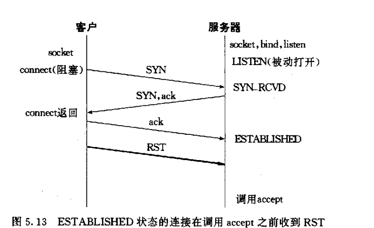

# TCP客户-服务器程序例子
## Posix 信号处理
```c
信号是发生某事件对进程的通知,有时称为软中断


//进程发送的来源
进程 -----> 进程 (信号)
内核 -----> 进程 (信号)


SIGCHLD
   某一个进程终止 发送给父进程的信号


```
## 处理SIGCHLD 信号
```c
Zombie 状态的目的 维护子进程信息,以便某个时刻取回


如果一个进程终止,且该进程有子进程处于Zombie 所有僵尸进程的的父进程ID 设置为 1 init 进程
```

### 处理僵尸进程
```c
僵尸进程占用内核空间

解决子进程变为僵尸进程
1.父进程sigaction 注册SIGCHILD 捕获信号
   在处理程序中调用wait


    struct sigaction sig = {0};

    sig.sa_handler = &sig_handler;
    sig.sa_flags = SA_RESTART;

    // 清空屏蔽信号集合
    sigemptyset(&sig.sa_mask);
    sigaddset(&sig.sa_mask, SIGTERM);
    sigaddset(&sig.sa_mask, SIGQUIT);

    sigaction(SIGCHLD, &sig, NULL);


// 信号处理函数
void sig_handler(int signum)
{
    int status = 0;
    pid_t pid = wait(&status);

    if (pid > 0)
    {
        printf("pid %d exit status:%d\n", pid, status);
    }
}


// 阻塞 connect 发生 EINTR 解决方式
connect() 阻塞 如果  errno=EINTR 不能再次调用


errno==EINTR // 并不表示 发生错误 可能里面还在处理连接可以绑定
select 监听是否有可写事件监听是否连接成功

// 解决方式
  if(errno==EINTR){
    

     poll 监听课写集合

  }


```

## wait waitpid

```C
unix 信号不排队 如果正在处理某个信号 这个时候出现了某个信号会忽略


// 解决一次性同时都多个 SIGCHLD 信号来位接收完全bug
void sig_handler(int signum)
{
    int status = 0;
    pid_t pid;

    while ((pid= waitpid(-1,&status,WNOHANG))>0)
    {
        printf("pid %d exit status:%d\n", pid, status);
    }
}


```

## accept 返回前连接夭折

```c
出现情况
1.三次握手 连接建立 此时还在连接队列里面
2.此时客户端TCP 发送RST 到达服务器
3.调用accept


如何处理夭折的连接?
1.大多数OS实现 accept() =-1 返回一个错误 给errno
  SVR4
    EPROTO 协议错误


  POSXI 支出必须返回 ECONNABORTED(软件引起的连接夭折)
  

ECONNABORTED 错误 我们可以忽略该错误 在次调用 accept


2.有的实现直接从连接队列删除让上层调用accept() 根本不知道有一个连接夭折
```

## SIGPIPE 信号
```c
当一个进程向接收了RST套接字写数据的时候内核向该进程发送SIGPIPE信号,该信号会让程序终止

如果不想让程序不情愿终止,则可以捕获该信号

SIGPIPE 是否捕获, write() 返回 -1 并且 errno == EPIPE

如何避免SIGPIPE
1.signal(SIGPIPE, SIG_IGN);
2.自定义信号处理

```

## 服务器主机崩溃
```c
1.只有主动向服务器发送数据时，才能检测出其崩溃/不可达

2.
    2.1 SO_KEEPALIVE
    2.2 心跳检测
```

## 服务器崩溃后重启
```c
服务崩溃重启 
1.客户端不发送任何信息
2.没有设置 SO_KEEPALIVE
此时客户端就不会知道服务器崩溃


3.此时服务器重启 
4.客户端向服务器发送一行数据
   由于重启 服务器丢失了客户端所有的连接信息
   服务器接收到旧的连接数据报文会响应RST
5.随后操作中 会收到 ECONNRESET  网络错误
```
## 服务器主机关机
```c
unix 关机信号流程

1.init 向所有进程发送 SIGTERM 信号(可以捕获)
2.等待固定时间(5-20s)
3.向仍在运行的进程发送 SIGKILL（不可捕获、不可忽略)
4.个进程一小段时间做清理和终止


服务器进程两种结局
1.捕获SIGTEM 主动终止 可以优雅关闭
2.不捕获SIGTERM 等待 SIGKILL 强制终止

note:
   自己关闭 和 SIGKILL 描述符都会关闭发送FIN 客户端能监听到连接正常关闭


```