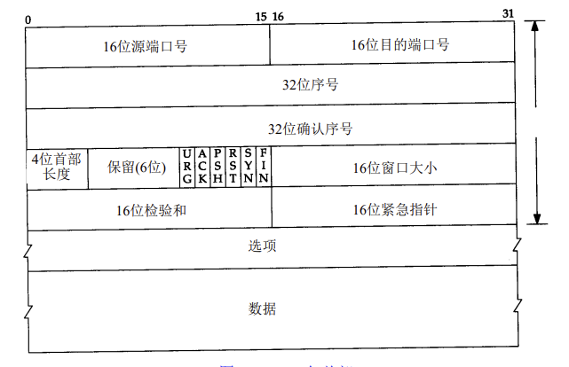
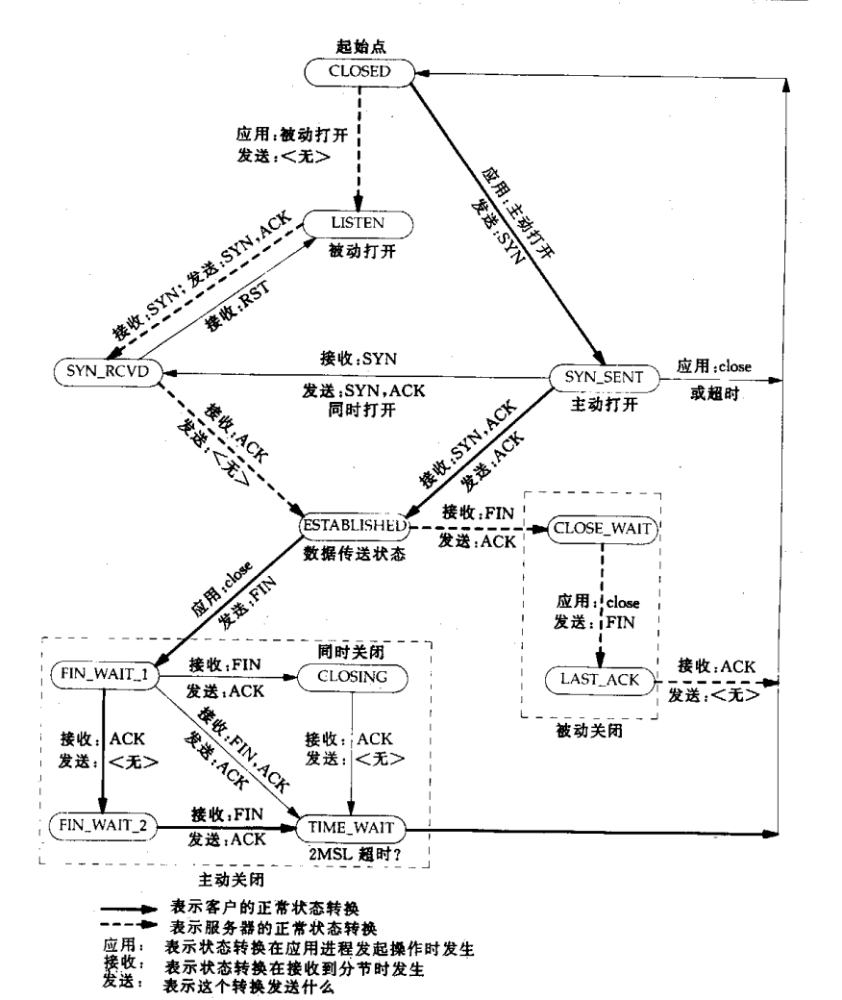

# UNIX网络编程

## TCP 连接的建立和终止

```cpp
服务器
    1.socket
    2.bind
    3.listen
        监听一个端口,被动的接受外来的连接
    
客户端
    1.socket
    2.connect
        主动连接服务器
    


Client connect

Client  SYN  seq N------------> server

Client   <------------------------------- SYN seq K ACK N+1 server

Client   seq N+1 ACK K+1 ----------------> server


client 初始序号 N
server 初始序号 K

ACK 回复期望是上一次seq+


```
### TCP 选项
```
SYN 消息 可以含有若干个选项
```

### TCP 连接的终止
```

client close() ------------------------>  FIN seq M server 


// 处于半关闭状态  客户端发送端已经关闭 服务器接收端关闭
server  read()
        1.读完数据 
        2.read() 返回0 

        // ACK 发送时机取决于协议栈的实现机制
        ------------------------------------>ACK M+1 client 

server close() ------------------------>  FIN seq N server 
client ---------------------------------->ACK N+1 server 
  client (TIME_WAIT 状态  2MSL 才真正关闭)


```

### TCP 状态转换图

```
Piggybacking ACK(捎带确认):

数据包响应处理时间少于200ms 则捎带确认


// 数据包
ACK ACK_NUM  SEQ_NUM 数据


close()---------------FIN N----------------> FIN read/recv() ==0
FIN_WAIT_1                             CLOSE_WAIT(被动关闭)

<------------------  ACK N+1 ----------------------------

FIN_WAIT_2


<---------------------FIN k-----------------------close()
TIME_WAIT                                  LAST_ACK

------------------------ACK k+1-------------------------->
                                          CLOSED
TIME_WAIT 要 等待 2MSL才变为CLOSED

MSL:
    RFC1122 建议是2分钟
    Berkeley 实现传统使用的是30s
    TIME_WAIT 将在 [1,4] min


TIME_WAIT 存在的理由:
1.实现终止的全上工连接的可靠性
    防止ACK丢失 2MSL 之内网络对象都不会销毁会维护网络状态 用来接收
    FIN 包 返回ACK


2.允许老的重复分解在网络中消失(让在网络中未到达的包 在网络中消失)
    防止 上一次同ip 端口的信息进入到这一次读取的数据中

    2MSL 时间 足够能让一个信息超过网络的存活时间,即使数据来了 超过了网络存活时间也会被丢弃


bind ADDR-ANY  绑定任意IP地址


```

### 缓冲区大小的限制
```cpp

IPV4 数据报最大  65535 字节 (IP 头表示数据长度16bits 0xFF FF)
   
   IPV4 Header 20 bytes  + 数据 
      数据 最大 65535 - 20 = 65515 bytes


MTU(maximum transmission unit) 最大传输单元 硬件规定
以太网MTU 1500 bytes


MTU 是链路层的概念 它约束链路层帧中有小载荷的的最大尺寸

MTU 不包含 链路层头部 和 帧尾部


IPV4 最小的MTU 68 bytes,IPV6 最小MTU 576 bytes


1500 是以太网MTU,A-B路径直接最小的MTU称为该路径的MTU
    A->B  B->A 他们的路径MTU 可以不通 (非对称)


发送数据IP数据报超过MTU 分片
1.IPV4 
    主机分片+IPV3路由器分片转发
2.IPV6 
    主机分片+IPV6路由器不分片转发
    

    note:
        IPV6 路由器只会对自己产生的IP数据包进行分片
        而不会对转发的数据分片


IPV4 标志位(3bits)
1.保留bit
2.DF(don't fragment) 不分片
  1.禁止分片(发送主机和发送路由器都不能分片)
  0.允许分片(默认性)
3.MF(more fragment) 更多分片
    1

note: DF 设置 为 1 整条路径上的主机和路由器都不能违背


IPV6
   隐藏将DF 位设置为 1 
   超过路由器MTU  路由器丢弃 消息 返回ICMP  "packet too big"


例如:
1.DF 1 报文长度1500
    路由器 MTU 1000
    报文长度 >MTU 
    丢弃数据 + 会 ICMP 错误 (ICMPv4: "destination unreachable, fragmentation needed but DF bit se)


最小重组缓冲区大小(Minimum Reassembly Buffer Size)
  主机接收能力的下线 保证报文能被收下并拼好


IPV4 最小重组缓冲区(576 bytes)
    IPV4 数据报<=576 一定能收 不分片


UDP 避开 576byte 最好小于 576bytes
    1.UDP 没有重传机制
    2.UDP 超过MTU IP 层分片(增加数据丢失风险)
       IP 分片  数据从组发现数据不全 丢弃

    


TCP MSS (Maximum Segment Size，最大段大小)

MSS:TCP 每个分节中最多能发多少字节TCP数据

TCP 连接的时候通过SYN 消息携带MSS 选项

#include <netinet/tcp.h>
setsockopt(listenfd, IPPROTO_TCP,
           TCP_MAXSEG, &mss, sizeof(mss))


默认 
    MTU 1500-IPV4头-TCP头 1500-20-20 = 1460
    MTU 1500-IPV6头-TCP头 1500-40-20 = 1440


MSS目的:
    1.告诉对方我接收的缓冲去能装下这么大的TCP段 按这个发 不要超了
     
     发送方获取到该数据 控制TCP 发送每段TCP 大小

      只要按照该大小发送IP 报文也不会被分片


note:如果对方未在SYN 中携带 MSS 信息 使用默认536(576-20-20)


write()/send()
   返回 > 0
    只表示 写入到协议栈缓冲去数据的大小

阻塞
1.协议栈缓冲区空闲位置 大于写入空间 一次拷贝完 返回 
2.进入睡眠 等待缓冲区有空闲位置继续拷贝 直到拷贝完


非阻塞
1.返回拷贝数自己 or 返回EAGAIN or EWOULDBLOCK


```

### UDP 输出
```
udp 没有缓冲区

SO_SNDBUF  只能设置当数据报上限大小

TCP  write() 返回

    1.将数据拷贝到协议栈
    2.等待协议栈发送
    3.协议栈发送数据并且保留数据等待ACK确认
    4.超时未返回ACK 从传,返回ACK 删除对应的数据

    ....


UDP sendto() 返回
    1.UDP Header + 数据
    2.IP + UDP Header + 数据
    3.假如链路层的输出队列


```