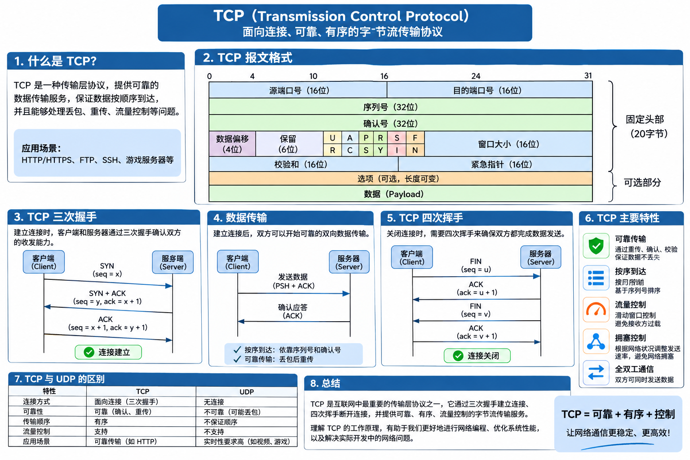

# socket
## 网络包
```
1.[用户数据]
2.[AppHeader][用户数据]
3.[TCP Header][AppHeader][用户数据]
socket send
4.[IP Header][TCP Header][AppHeader][用户数据]

5.[Ethernet Header][IP Header][TCP Header][AppHeader][用户数据][Ethernet Footer]
  


```
## samba 服务器安装配置
```
apt install samba -y


/etc/smb.conf
[code]
path=/code
writeable=yes
browseable=yes
guest ok=yes


pkill smbd
smbd

创建code 目录
mkdir /code
给权限
chomd 777 code 


note:
windows 11 需要设置  允许 Guest 匿名访问 和 关闭强制 SMB 签名

Set-SmbClientConfiguration -RequireSecuritySignature $false -Force

Set-SmbClientConfiguration -RequireSecuritySignature $false -Force
```

## 套接字
```
linux os 非实时OS

socket send 并不是 立即发送数据, OS 排队做这些事情


```

### Windows
```cpp
ws2_32.lib 需要加载动态库

// 从内存加载socket动态链接库并且设置引用 初始化
WSAStartup(MAKEWORD(2, 2), &ws)
```

## Linux
```cpp
linux
ulimit -n 查看文件数量限制
ulimit -n value 设置文件数量限制
```

## TCP

```
1.面向连接
2.可靠,重传，RTT的估算
3.TCP 通过给发送数据的每一段管理一个序列号进行排序
4.流量控制 和拥塞控制
5.TCP 连接是全双工的(发送和接收能同时发生 走的不通的线)


网络字节序都是大端字节序

```

## 读取数据
```cpp

linux:
read
recv 

window:
recv

为了程序的可移植性, 使用recv 函数


```
## 发送信息
```
linux:
send
write

windows write


```
```
recv 和 send 都不能将数据一次接收或发送

```

## XTcp动态链接库制作
### Windows
[link](https://learn.microsoft.com/zh-cn/cpp/build/walkthrough-creating-and-using-a-dynamic-link-library-cpp?view=msvc-180)
```
设置不使用预编译头


note: 如果动态链接库要使用其他动态链接库
#pragma comment(lib, "Ws2_32.lib")


or

项目属性
  └── 配置属性
       └── 链接器
            └── 输入
                 └── 附加依赖项

假如对应的动态库


```

### 调整代码结构
```
./src  项目
./lib 动态链接库
./bin
./doc 


windwows visual studio 设置对应的路径
   输出目录
   调试工作目录
   连接器/高级导入库 


 头文件引入设置:
属性->C/C++->附加包含目录

动态链接库引入
1.设置目录地址
  属性 常规 附加库目录
3.设置链接库名称
  连接器 附加依赖性  xxx.lib;

```

### Linux 动态链接库制作
```
libxsocket.so:XTcp.h XTcp.cpp
g++ $+ -o $@ -fpic -shared --std=c++11 

$+ 依赖项：XTcp.h XTcp.cpp

$@  libxsocket.so 目标名

-fpic 生成与位置无关的代码
-shared 生成共享库

note: 
    linux 动态链接库命名规则 libxxx.so


tcpserver:server.cpp
# -I../xsocket 引入头文件地址
# -lxsocket 引入动态库 
# -L ../xsocket 引入动态库地
	g++ $+ -o $@ -I../xsocket --std=c++11 -lpthread -lxsocket


linux 动态链接库地址
LD_LIBRARY_PATH 环境变量设置

or 将动态链接库放 在
/lib/
/usr/lib/


```

## 客户端代码
```
1.socket 创建
2.connect 连接 TCP 三次握手
    C----------SYN J--->S

    S-----------SYN K ACK J+1------------->C
    
    // 客户端 能发送 和接收数据


    C----------- ACK k+1------------->S

    // 服务端 能 发送接收数据


    
3.send 发送数据
4.recv 接收数据
5.close 关闭连接


```

## socket 的阻塞和非阻塞
### socket 超时功能
```cpp
连接的时候使用非阻塞模式 + select 来做超时


// 怎样设置阻塞和非阻塞
windows

unsigned long ul = isBlock ? 0 : 1;
// 0 阻塞 1 非阻塞
ioctlsocket(sock, FIONBIO, &ul);


linux

int flags = fcntl(sock, F_GETFL, 0);
if (flags < 0) return false;
if (isBlock) { 
	flags = flags & ~O_NONBLOCK;
}
else
{
	flags = flags | O_NONBLOCK;
}
flags = fcntl(sock, F_SETFL, flags);
if (flags != 0) return false;


select 

#include <sys/select.h>
typedef /* ... */ fd_set;
// fd_set 操作函数

fd_set set;

 // 将fd 从文件描述符中移除
 void FD_CLR(int fd, fd_set *set);
 // 文件描述符是否在集合中
 int  FD_ISSET(int fd, const fd_set *set);
 // 文件描述符设置到集合
 void FD_SET(int fd, fd_set *set);
 // 清空 fd_set 整个集合
 void FD_ZERO(fd_set *set);


       
int select(int nfds, fd_set *_Nullable restrict readfds,
                  fd_set *_Nullable restrict writefds,
                  fd_set *_Nullable restrict exceptfds,
                  struct timeval *_Nullable restrict timeout);


nfds:最大文件描述符+1
    note:在Linux中必须设置 并且必须设置正确
readfds 读取文件描述符集合
writefds 写入文件描述符集合
exceptfds 异常文件描述符集合
timeout 超时时间


return 
    > 0发生事件文件描述符数量
    =0 超时

    -1：发生错误通过 errno 查看


通过 FD_ISSET判断 是否在该集合里面


note:
    select 设置超时 讲究会阻塞 知道等到有事件或吵死
    timeout 设置为null select 一直阻塞到有事件可以使用

```
