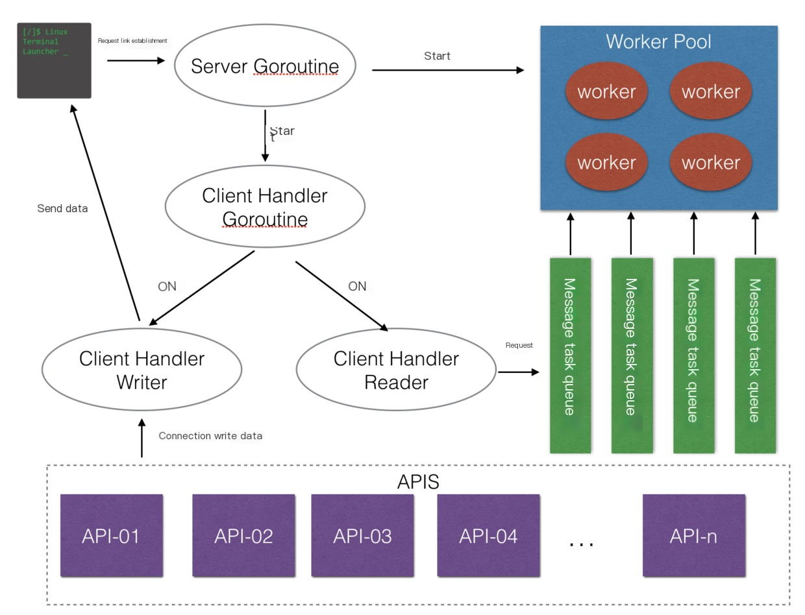

# Zinx
## 介绍

## Zinz Router
```golang
type IRouter interface {
	PreHandle(request IRequest)  //Hook method before processing conn business(在处理conn业务之前的钩子方法)
	Handle(request IRequest)     //Method for processing conn business(处理conn业务的方法)
	PostHandle(request IRequest) //Hook method after processing conn business(处理conn业务之后的钩子方法)
}


调用顺序 PreHandle(request IRequest)->Handle(request IRequest) -> PostHandle(request IRequest)


```

### Router 链路跳转
```golang
Handle(request IRequest)  里面使用使用
request.Abort 和 request.Goto 来终止或者跳转到对应的回调节点


跳转至链路，跳转节点提供三个宏
znet.PRE_HANDLE
znet.HANDLE
znet.POST_HANDLE
```

## Zinx Server/Client (服务/客户端实例)
### Server
```golang
Server 会默认加载 $PWD/conf/zinx.json 配置文件

```
### Server配置hook
```golang


// 连接之前调用
func (s *Server) SetOnConnStart(hookFunc func(ziface.IConnection)) {
	s.onConnStart = hookFunc
}

func (s *Server) SetOnConnStop(hookFunc func(ziface.IConnection)) {
	s.onConnStop = hookFunc
}
```
## Zinx Connection 
### 设置链接携带属性参数信息
```golang 

//给当前的IConnection设置携带属性参数
conn.SetProperty("Name", "aceld")
conn.SetProperty("Home", "https://www.yuque.com/aceld")


//获取链接携带的熟悉参数
name, _ := conn.GetProperty("Name")
home, _ := conn.GetProperty("Home")
```
### CloseCallback 设置
```golang

// 作用

// Handle
func (t *TestRouter) Handle(req ziface.IRequest) {
    
server端可以使用AddcloseCallback来添加任意个回调函数，触发时机是在conn.close时。通常用于断线时业务层的一些通知补发、数据清理工作。

	req.GetConnection().AddCloseCallback("handler", "key1", func() {
		// 通知所有房间内用户我掉线了~~~
	})

    req.GetConnection().AddCloseCallback("handler", "key2", func() {
		// 清理掉线用户的数据~~~~~
	})

    // 移除掉key2这个closecallback
    req.GetConnection().RemoveCloseCallback("handler", "key2")

}


用法2

// 在连接开始之前添加上 CloseCallback 回掉
s.SetOnConnStart(DoConnectionBegin)

func DoConnectionBegin(conn ziface.IConnection) {
	fmt.Println("Server connection started")

	// Set connection properties / 设置连接属性
	conn.SetProperty("StartTime", time.Now())

	// Add close callback function - cleanup resources / 添加关闭回调函数 - 清理资源
	conn.AddCloseCallback("cleanup", "resources", func() {
		fmt.Printf("Cleanup resources for connection %d\n", conn.GetConnID())
	})

	// Add close callback function - record statistics / 添加关闭回调函数 - 记录统计信息
	conn.AddCloseCallback("stats", "record", func() {
		if startTime, err := conn.GetProperty("StartTime"); err == nil {
			duration := time.Since(startTime.(time.Time))
			fmt.Printf("Connection %d duration: %v\n", conn.GetConnID(), duration)
		}
	})

	// Add close callback function - notify other components / 添加关闭回调函数 - 通知其他组件
	conn.AddCloseCallback("notification", "broadcast", func() {
		fmt.Printf("Notify other components: connection %d disconnected\n", conn.GetConnID())
	})
}
```
## Zinx HeartBeat (心跳检测)
### 心跳检测HeartBeat机制
```golang
心跳检测机制是双向的,Server 可以发送给Client,Client 也可以发送给客户端


heartbeat.go

func (h *HeartbeatChecker) check() (err error) {

	if h.conn == nil {
		return nil
	}

	if !h.conn.IsAlive() {
		h.onRemoteNotAlive(h.conn)
	} else {
        // 发送心跳消息
		if h.beatFunc != nil { // 用户自定义心跳发送函数
			err = h.beatFunc(h.conn) 
		} else {
			err = h.SendHeartBeatMsg()
		}
	}

	return err
}


onRemoteNotAlive
    检测到已经超过最大 zconf.GlobalObject.HeartbeatMaxDuration() 表示当前连接没有或者 服务端主动断开连接

```

### 自定义心跳检测消息及处理机制
[link](https://www.yuque.com/aceld/tsgooa/ogzff36l2hgxnvol)

## Zinx WebSocket （Web长链接）
```
zinx.json

{
      "Mode":"websocket"
}

```


## Zinx WorkerMode（协程池工作模式）
```golang
zinx.json
{
     "WorkerMode":"Hash"
}

Hash 默认
    workerId=connectionId % workerPoolSize 


Bind 
    每创建一个Connection链接都会与之绑定一个WorkerId, 这样可以保证同一个链接的数据都由同一个Worker处理,直到WorkerPoolSize填满为止。


DynamicBind
    在Bind模式下优化,更具负载动态启动worker

```
### WorkerMode Bind 适用场景（面向的问题）
```
Hash 模式下如果发生大量阻塞式操作(RCP 数据库访问 读写文件 等操作)则会发生CPU 未占满则连接数上不去的操作

Hash 模式下会出现一个worker 会存在多个链接的情况,如果A阻塞此时B什么也不能做这样就会照成一个连接会影响另一个连接


```